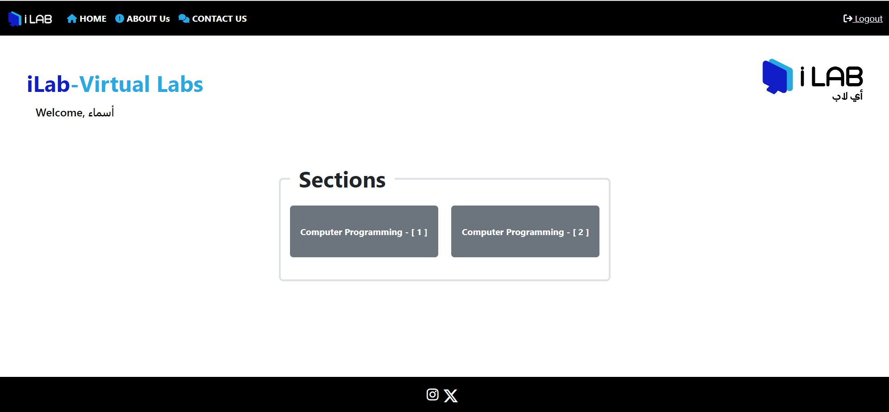
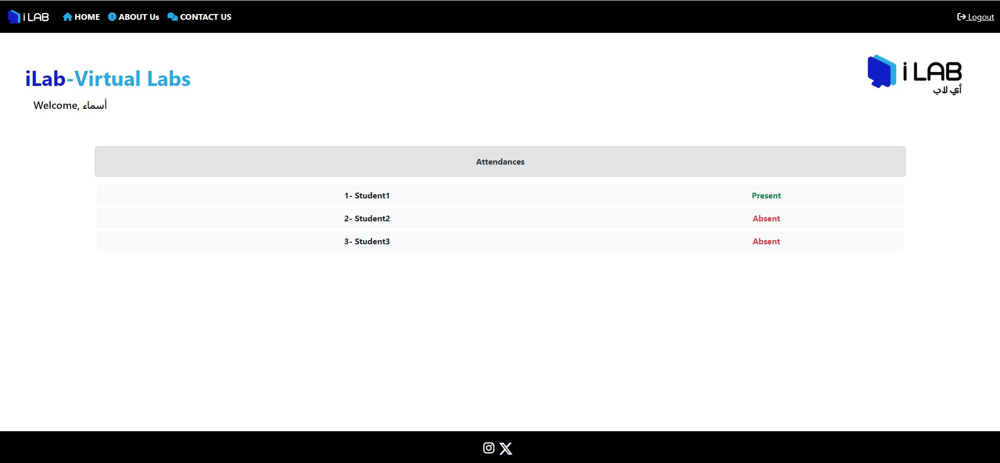
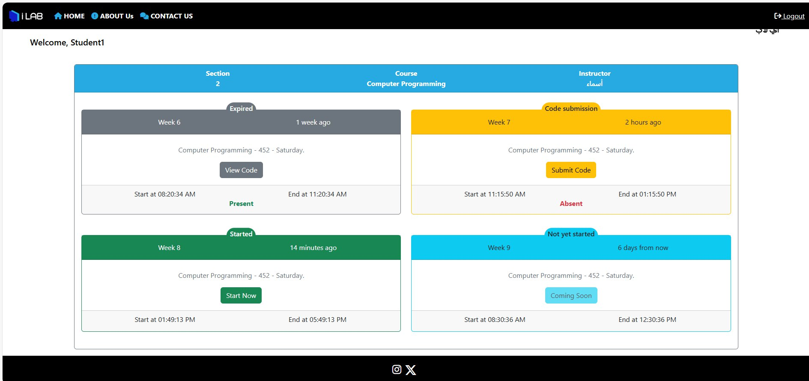
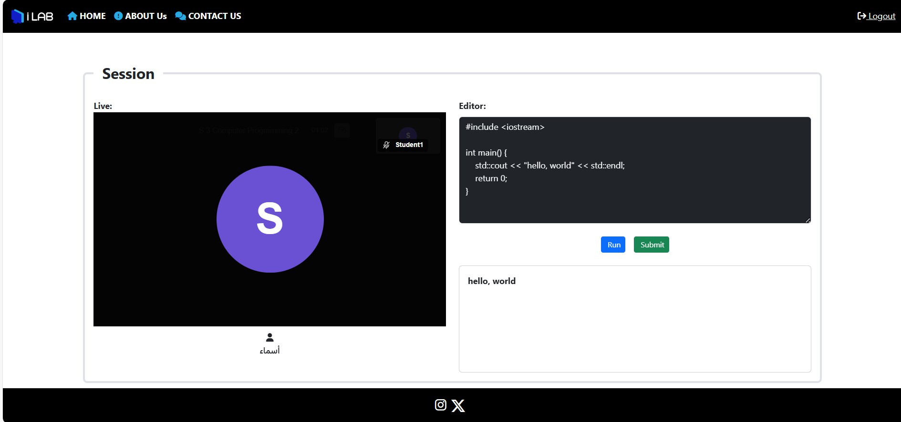

# Interactive TU-Virtual Labs

A web-based virtual programming lab for the College of Computer Science and Information Technology at Taif University. Students practice coding and join live lab sessions from anywhere, while instructors run sessions, follow each student's work, and review submissions.

> Graduation project by a team of six students, supervised by Dr. Wael Y. Alghamdi.

## Why this project
The number of students in the college has grown quickly, but physical labs and devices have not (at most 20 labs across the male and female sections). That limits hands-on practice time. This platform moves part of the lab online so practice is not tied to a room or a schedule.

## Objectives
- Make faculty monitoring of practical work easier
- Let students practice at any time
- Reduce lab costs
- Support remote learning
- Strengthen instructor and student interaction

## Features

### Live programming sessions
- Split-screen view: the student follows the instructor's demonstration while working on their own code
- The instructor can open any student's screen from the participant list
- Students submit their work during the session, and a completion indicator shows the instructor who has finished
- Real-time updates through Pusher, and video meetings through Jitsi Meet

### Practice labs and code editor
- Built-in editor for writing and running code
- Code is executed by the Judge0 API (through RapidAPI)
- Submissions are stored with the platform

### For students
- Dashboard, enrolled courses and sections, schedules
- Practice labs and live sessions
- Submissions and attendance

### For instructors and admins
- Dashboard, section and schedule management
- Run and monitor live sessions
- Review submissions and attendance
- Excel import and export (users, sections, schedules, attendance, marks)

## User provisioning
There is no public sign-up. Accounts are created by an administrator through an Excel import, which fits a university setting where student records already exist elsewhere. Passwords are hashed before they are stored.

## Tech stack
| Layer | Technology |
| --- | --- |
| Backend | PHP, Laravel |
| Frontend | Blade, HTML, CSS, JavaScript, Vite |
| Database | MySQL |
| Real time | Pusher |
| Code execution | Judge0 API |
| Video | Jitsi Meet |
| Data import/export | Laravel Excel |
| Methodology | Agile |

## My contribution
- Designed the UI/UX of the platform's interfaces
- Built the login and authentication pages
- Worked on the MySQL database design (schema, table relationships, queries)

## Published research
A paper based on this project was published in *Procedia Computer Science* (Elsevier, ScienceDirect):
[Read the paper](https://linkinghub.elsevier.com/retrieve/pii/S1877050924033313)

## Team
Developed by a team of six students at the College of Computer Science and Information Technology, Taif University, under the supervision of Dr. Wael Y. Alghamdi.

## Project structure
```
app/         Controllers, models, imports, exports, services
database/    Migrations, factories, seeders
resources/   Blade views, CSS, JavaScript
routes/      web.php, api.php, channels.php
public/      Entry point and static assets
```

## Database
The migrations create the schema: users, semesters, courses, sections, student sections, schedules, weeks, submissions, and attendances.

## Getting started

**Requirements:** PHP 8.2+, Composer, MySQL (for example via XAMPP), Node.js and npm.

1. Clone the repository
   ```bash
   git clone https://github.com/noufSh0/TU-Virtual-Lab.git
   cd TU-Virtual-Lab
   ```
2. Install dependencies
   ```bash
   composer install
   npm install
   ```
3. Create the environment file and app key
   ```bash
   cp .env.example .env
   php artisan key:generate
   ```
   On Windows: `copy .env.example .env`
4. Create a MySQL database and set it in `.env`
   ```
   DB_DATABASE=your_database_name
   DB_USERNAME=root
   DB_PASSWORD=
   ```
5. Add your own service keys in `.env`
   ```
   RAPIDAPI_KEY=
   PUSHER_APP_ID=
   PUSHER_APP_KEY=
   PUSHER_APP_SECRET=
   PUSHER_APP_CLUSTER=
   ```
6. Create the tables and build the assets
   ```bash
   php artisan migrate
   npm run build
   ```
7. Start the server
   ```bash
   php artisan serve
   ```
   Then open http://127.0.0.1:8000

## Security and data privacy
This repository does not include `.env` files, API keys, database passwords, the production database, or any real student data. All secrets are read from environment variables. Never commit your `.env` file.

## Screenshots

**Instructor: sections**


**Instructor: attendance**


**Student: weekly schedule and live session status**


**Student: live session with code editor**


## License
Developed as an academic graduation project. Please contact the authors before reusing, redistributing, or deploying it commercially.
